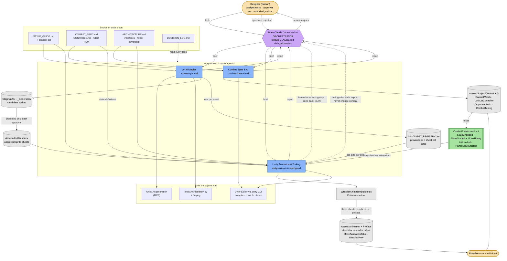
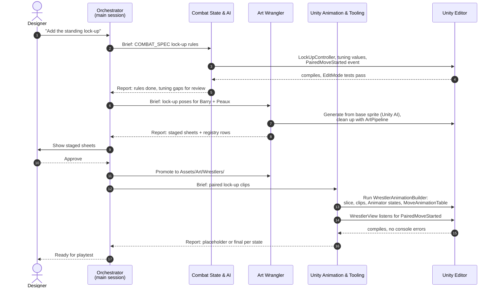

# Rural Rumble Agent Crew: Diagrams

Two views of the same crew. The first shows **roles, connections, and data flow**.
The second shows **the order agents work in** on one real feature (the lock-up).

## 1. Roles, connections, and data flow

**Legend**

| Shape / color | Meaning |
|---|---|
| Yellow rounded | Human designer, and the final playable result |
| Purple hexagon | Orchestrator (main Claude Code session) |
| Blue box | Crew agent (one `.claude/agents/*.md` file each) |
| Gray cylinder | File or asset one agent writes and another reads |
| Green box | Code contract between Combat and Animation |
| Solid arrow | Data or delegation |
| Dotted arrow | Feedback, approval, or "read but don't write" |

## 2. Order of work on one feature: the lock-up

The lock-up is in progress on the `lock-ups` branch. Its combat rules and animation states exist, and
the clips are marked placeholders until the art steps (6–11) are approved.

